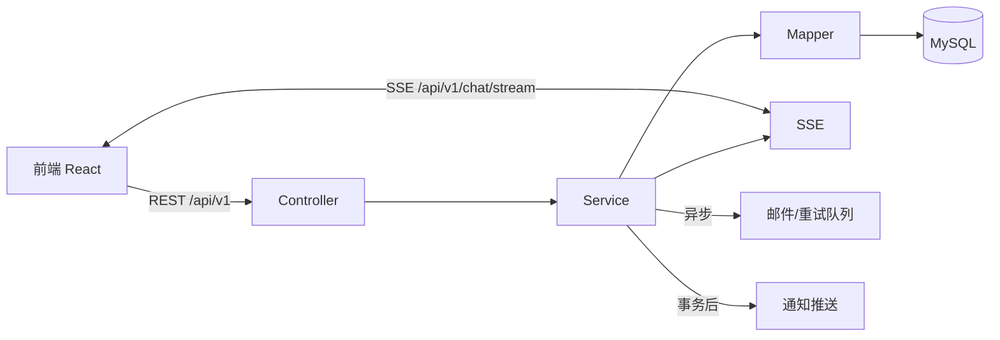

# 总体架构

## 项目定位

面向高中校园的失物招领系统：发布失物/招领、提交与处理认领申请、站内通知与
聊天、离线邮件提醒、管理后台。

## 技术栈

| 层 | 选型 |
|---|---|
| 后端 | Spring Boot 3.3.5 · Java 21 · MyBatis-Plus 3.5.5 · MySQL 8 · Spring Security + JWT · SSE · Spring Mail · Apache POI |
| 前端 | React 19 + TypeScript · Vite 8 · MUI 9 · axios · i18next · EventSource |
| 附加服务 | `backend/postgen-service/`：Node 边车服务，用 satori + resvg 生成文字封面图 |

## 部署原则

- **前后端分离、独立部署**：`backend/` 与 `web-frontend/` 是两个独立部署单元，
  可分别部署在不同机器；实体部署（不使用 Docker），后端为 jar 进程，前端静态
  资源由任意静态 Web 服务器托管（部署方式见 `docs/deployment.md`）；
- 后端的一切运行产物（jar、配置、日志、上传）限定在 `backend/` 目录内；
- 前端构建产物限定在 `web-frontend/dist/`。

## 仓库结构（开放目录）

```
├── backend/                     # Spring Boot 后端
│   ├── src/main/java/me/qscbm/projects/lostfound/
│   │   ├── controller/          # REST 控制器（API 入口）
│   │   ├── service/             # 业务接口与实现
│   │   ├── mapper/              # MyBatis-Plus 数据访问
│   │   ├── entity/ dto/         # 实体与传输对象
│   │   ├── common/              # 统一响应/异常/工具
│   │   ├── config/              # 配置与数据库初始化
│   │   └── security/            # JWT 与 HTTP 安全过滤
│   ├── src/main/resources/
│   │   ├── application.yml      # 配置（全量环境变量化）
│   │   ├── logback-spring.xml   # 控制台 + 文件日志
│   │   └── db/                  # SQL 初始化与迁移脚本
│   ├── postgen-service/         # postgen2 修改版源码 + 封面生成服务（Node）
│   ├── deploy-app.bat / .sh     # 本机 jar 部署脚本
│   ├── start-app.bat / .sh      # 本机一键启动脚本
│   ├── .env.example             # 部署环境变量模板
│   └── CONFIG.md                # 完整配置项说明
└── web-frontend/                # React 前端
    ├── src/                     # 源码（api/components/pages/store/i18n）
    └── vite.config.ts           # 构建配置
```

## 分层与调用链

`Controller → Service → Mapper → MySQL`，统一返回
`{code, message, data}`，全局异常处理统一转义为业务错误。



## 关键数据流

### 失物/招领发布与认领

1. 用户发布失物/招领（图片上传时压缩到 1080P）；
2. 他人提交认领申请（数据库唯一键防重复）；
3. 发布者处理申请：通过 → 物品置为已解决（图片压到 540P）、级联拒绝其他申请、
   自动创建会话、通知 + 邮件（事务提交后）；
4. 双方进入站内聊天。

### 离线消息与邮件

1. 消息发送时接收者离线 → 会话纳入内存跟踪器（需邮件资格）；
2. 每 3 分钟定时任务汇总未读并发一封摘要邮件（每轮离线仅一次，24 小时后可
   再次提醒）；
3. 邮件含跳转链接，失败自动进入重试队列。

### 通知实时推送

通知落库后在事务提交后通过 SSE `notification` 事件推送；前端全局
EventSource 连接接收并更新铃铛角标。
